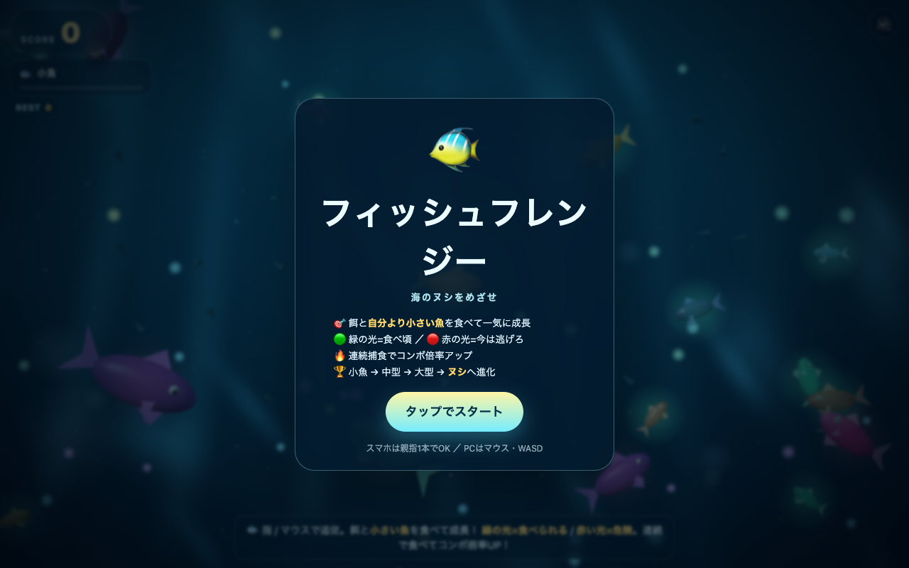

# フィッシュフレンジー 🐟 — 海のヌシをめざせ (SakanaGame)

A juicy underwater arcade game that runs in the browser. Eat smaller fish to grow, dodge the bigger ones, chain combos, and climb to the top of the food chain. **Every line of the game was generated by [Sakana AI](https://sakana.ai)'s Fugu model** — written and iteratively refined entirely through its API.



## Play

- **Live:** https://sakanagame.1qaz.jp
- **Mirror:** https://masafykun.github.io/sakana-game/
- **Local:** clone and open `index.html` (no build step, no install)

## How to play

- **Move:** mouse / touch to follow, or `WASD` / arrow keys
- **Grow:** eat food and fish smaller than you; chain eats for a **combo multiplier**
- **Survive:** avoid fish larger than you until you outgrow them
- **Goal:** reach the top size tier — the "ヌシ" (master of the sea) — and beat your best score

Features: feeding-frenzy growth tiers, particle bursts + screen shake, procedural WebAudio sound, combo scoring, boids fish schooling, high-score saving (localStorage), and a share button.

## How it was generated

The game was produced end-to-end through Sakana AI's OpenAI-compatible API, across three iterative calls — an initial generation followed by two refinement passes. Fugu is a learned multi-agent orchestration system: each request is fanned out across a pool of models, verified, and synthesized into one answer.

| Step | Model | Time | Result |
| --- | --- | --- | --- |
| Initial generation | `fugu-ultra` | ~864 s | base underwater fish game |
| Refinement | `fugu` | ~168 s | more food, difficulty scaling, bubble trail |
| Viral build | `fugu-ultra` | ~1768 s | combos, juice, audio, share, high score, boids, title screen |

The harness used to drive Fugu is in [`tools/gen.mjs`](tools/gen.mjs) (streaming, with full request/response logging).

## Tech

- [Three.js](https://threejs.org/) `0.160.0` (ES modules via import map)
- Single self-contained `index.html` — procedural geometry, shaders, lighting; no external assets
- Mobile and desktop, resize-aware, 60fps-minded

## Repository layout

```
index.html          the game (Fugu-generated)
screenshots/        title screen capture
tools/gen.mjs       the harness that called Fugu to generate and refine it
```

## License

[MIT](LICENSE). Game code generated by Sakana AI Fugu; repository published by Masato Suzuki ([@masafykun](https://github.com/masafykun)).
